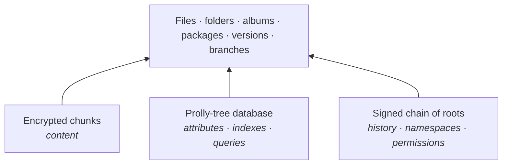

# retifs

> *Reticulum rethought how machines talk to each other. This rethinks how data lives.*

**retifs** (working title) is a distributed, always-encrypted data system built on [Reticulum](https://reticulum.network) (RNS). It combines **IPFS-style content addressing**, **BeFS-style attributes and queries** and **RNS identity and crypto**.

It has no files as such. Instead it has **records** (a stable ID, attributes and encrypted data blocks) and a **database**. Applications use it directly through a native API (records, attributes, queries, history; no paths), the way apps attach to a shared Reticulum instance. An ordinary file tree is just one view of that database, for legacy software.

> [!WARNING]
> **Status: working prototype, not for real data yet.** The formats are proposed and still change, and the crypto awaits external review (ADR-0008). The daemon, the native API, multi-writer namespaces, sync between nodes over Reticulum, a FUSE mount and a local web gateway work, and they have been tested across machines. See [Try it](#try-it).

## The shift

- **From location to identity**: data isn't "on server X". It's *mine*, wherever it physically lives.
- **From files to records**: data and its meaning, not names and folders.
- **From hierarchy to queries**: structure is what you ask of the data, not where you put it.
- **From trust to crypto**: you don't have to believe the server behaves.
- **From network dependence to independence**: the network is for syncing, not a prerequisite (local-first).
- **From machine to person**: the computer is hardware, and you are your key.

## Why Reticulum

| Reticulum | retifs |
|---|---|
| No IP addresses, only identities | No file paths, only records and namespaces |
| No central address allocation | No central server or owner |
| Works over any medium | Storage over any node, disk, stick |
| Crypto by default | Crypto by default, with no unencrypted mode |
| 300 bit/s to gigabit | Same dataset from LoRa to fibre |
| Needs no infrastructure | Works offline, syncs when it can |

## Three primitives



1. **Encrypted chunks.** Content-defined chunking, and each chunk is encrypted on its own. The CID is computed over the ciphertext, so storage nodes can verify integrity without ever seeing the content.
2. **Prolly-tree database.** Signed key-value attributes on records, held in content-addressed indexes. A folder is a query, and sync transfers only the branches that differ.
3. **Signed chain of roots.** A database root is a snapshot, and commits form the history. Namespaces are RNS destinations. Permissions are capability chains, with read = key and write = signature.

See the [architecture](docs/01-architecture.md) for details.

## Principles

1. **Always encrypted.** There is no unencrypted mode. "Public" means the key travels with the reference.
2. **Three primitives**, and everything else is a combination of them.
3. **Only RNS crypto primitives** (Ed25519, X25519, HKDF, AES + HMAC-SHA256). No new crypto.
4. **Local-first.** Writes are local and immediate.
5. **The BeOS way, not the WinFS way.** Free-form attributes, schema as convention, no relational engine.
6. **The file tree is a compatibility view,** not the primary interface.
7. **Storage nodes are blind.** They hold hash-addressed noise.

## Non-goals

- IPFS compatibility.
- Unencrypted storage.
- Being a relational database (no joins, no enforced schemas).
- Guaranteed deletion across the network. Deletion means destroying the key (crypto-shredding).
- A single global namespace replacing DNS.

## Try it

retifs runs on Linux and Windows (Haiku later). The daemon, `retifsd`, attaches to the machine's Reticulum shared instance, so start [prnsd](https://github.com/KenAKAFrosty/Prns) or Python `rnsd` first.

**Debian, Ubuntu, Raspberry Pi OS (amd64, arm64):** install a `retifs_*.deb` (built by `packaging/deb/build-deb.sh`) with `sudo apt install ./retifs_*.deb`. It brings prnsd along, started only where no Reticulum runs yet, and starts `retifsd` in every user's session; see `/usr/share/doc/retifs/README.Debian`. It needs glibc 2.36 or newer (Debian 12).

**From source:**

retifs builds against Prns 0.3.8, which isn't on crates.io yet. Check it out next to retifs (Cargo can't fetch the Prns repository on Windows: its paths are too long):

```sh
git clone https://github.com/KenAKAFrosty/Prns.git Prns-0.3.8
git -C Prns-0.3.8 checkout v0.3.8-hotfix.1
```

```sh
cargo install --path crates/retifs-node      # retifsd and the retifs CLI
cargo install --path crates/retifs-fuse      # retifs-mount (needs fuse3)
cargo install --path crates/retifs-gateway   # retifs-gateway
cargo install --path crates/retifs-extract   # retifs-extractd
cargo install --path crates/retifs-cloudfiles   # on Windows: retifs-cloudfiles
cp packaging/systemd/*.service ~/.config/systemd/user/
systemctl --user enable --now retifsd
```

**Settings** live in `retifs.toml` in the store (`~/.local/share/retifs/` on Linux, `%LOCALAPPDATA%\retifs\` on Windows), made with every setting commented out on first start: disk budget, device name, how often to announce, how much to hold for others, and so on. Flags given to `retifsd` override the file.

Records, attributes and queries:

```sh
retifs rec add photos album="Prangli 2026" --file boat.jpg
retifs query photos 'album=Prangli 2026'
retifs rec history photos <id>
retifs query '*' type=photo --save Photos   # saved in your namespace me: every device has it
retifs saved run Photos --watch             # live: again whenever it changes
```

As a file tree, on Linux and Windows alike:

```sh
retifs mount photos            # ~/retifs/photos (or give a folder)
retifs mount                   # what's mounted where
retifs unmount photos
retifs mount photos --via home # a namespace your home node holds, nothing of it kept here
```

(For `--via`, the home node admits this one first: `retifs app add laptop --ns photos --write --device <this node>`; `home` is a contact or a node address.) To read a namespace someone shared with you, join it (`retifs open LINK`, or `ns join --lazy` to fetch only what's opened) and mount it like your own.

On Linux it's a FUSE mount (attributes are `user.retifs.*` xattrs; `.query/<terms>/` lists matches, e.g. `ls ~/retifs/photos/.query/album=Prangli\ 2026/`); `systemctl --user enable --now retifs-mount@photos` mounts it at login. On Windows it's a folder in Explorer: files are fetched when opened, "Always keep on this device" sets this device's keep tag, and **Share with retifs…** is in the context menu; a namespace you may only read is a read-only folder; `retifs unmount photos --forget` also removes it from Explorer.

As websites, one origin per namespace, read-only: `systemctl --user enable --now retifs-gateway`, then open <http://localhost:8740/>.

**Attributes from what's in files**, as BeOS gave files theirs when they arrived: `retifs-extractd` watches your libraries and describes new content, whatever route it came in by: `mime` and `type`, a photo's size, `camera`, `taken` and `geo`, a recording's `audio.artist`, `audio.title` and `duration`, a document's `doc.title`, `doc.author` and `doc.pages`. Then `retifs query photos has:camera` or `type=audio audio.artist=Bach` finds them. It's an app that may write only those keys: `retifs app add extract --ns photos,music --write --keys mime,width,height,taken,camera,geo,duration,'exif.*','audio.*','doc.*','block:*',@content,type,extracted > ~/.config/retifs/extract.token`, then `systemctl --user enable --now retifs-extractd` ([ADR-0023](docs/adr/0023-attribute-extraction.md)). One of your nodes running it is enough.

**Sharing a namespace** with another machine:
1. On your machine: `retifs ns link photos` prints a `retifs:ns/…` link (the address and your node).
2. On theirs: `retifs open <link>` joins it, reading.
3. To let them write too, give them an invitation instead: `retifs invite create photos` prints a one-use `retifs:invite/…` link; `retifs open <link>` joins and gets the grant in one step (or as soon as your node is reachable).
4. Both now write and sync.

**Contacts:** `retifs me link --name Alice` gives a link others add you with (`retifs open <link>`), and `retifs me` shows six words to compare in person; contacts live in your namespace `me`, and their names work in place of node addresses (`--from Alice`). Every file has three copies by default, yours and two on nearby nodes (encrypted; `retifs ns copies photos 4` sets a library's own number, `retifs nodes` shows the storage nodes this one knows). Give each node its site (`site = "prangli-home"` in `retifs.toml`) and one copy is always kept at another site. Each node pulls everything by default; for a small device, `retifs ns keep photos rules` and tag what it should keep: `keep:<device>=true`, or a keep-rule record.

**Sharing part of a namespace** (an album, a folder): `retifs share create prangli --from photos 'album=Prangli 2026' --omit geo` makes a namespace `prangli` holding just those records (without `geo`), kept up to date by your nodes, and prints its link for whoever should read it (`retifs open <link>`). `retifs share list photos` and `share rm` list and end shares.

## Roadmap

Prototypes are throwaway. They're for learning, not for locking in the format, and every phase ends in a usable system.

| Phase | Goal | |
|---|---|---|
| 0 | **Reconnaissance**: rnfs on a test mesh, reading, YubiKey firmware | partly |
| 1 | **Content layer**: Rust daemon on [Prns](https://github.com/KenAKAFrosty/Prns), per-chunk encryption, placement and repair, local HTTP gateway | prototype works |
| 2 | **Database**: records and queries, multi-writer commit chains, Prolly-tree state and checkpoints, keep rules | prototype works; blind index to do |
| 3 | **Identity & permissions**: capability chains, group keys, YubiKey-backed RNS identity | grants, revokes and key rotation work; ◀ next |
| 4 | **Linux client**: FUSE mount, attributes as xattrs, query directories | prototype works |
| 5 | **Thin client**: bootable USB stick plus YubiKey, with the system loaded from your namespace | |
| later | **Haiku client**: native attributes and live queries in Tracker | |

See the [prototype plan](docs/05-prototype-plan.md).

## Documentation

| Document | Contents |
|---|---|
| [Vision](docs/00-vision.md) | Paradigm, principles, non-goals, "why not X" |
| [Architecture](docs/01-architecture.md) | The three primitives and everything built on them |
| [Irreversible decisions](docs/02-irreversible-decisions.md) | Format and crypto decisions that can't change later |
| [Prior art](docs/03-prior-art.md) | BeOS, WinFS, IPFS, rnfs, Tahoe-LAFS, Dolt and others: what worked and what didn't |
| [Threat model](docs/04-threat-model.md) | Who we defend against (draft) |
| [Prototype plan](docs/05-prototype-plan.md) | Prototype-first ordering |
| [Open questions](docs/06-open-questions.md) | Unresolved topics |
| [Native API](docs/07-api.md) | `libretifs`: records, attributes, blocks, queries, history (draft) |
| [ADRs](docs/adr/) | Decision log |

## Contributing

Ideas are welcome in Discussions. The design direction is fixed and written down in the [vision](docs/00-vision.md). A proposal must support at least one principle and must not violate any. Big changes need a working prototype. The core is strict, while the ecosystem (applications, clients, tools) is open.

## Contact

Reach the author over Reticulum (LXMF, e.g. Sideband or NomadNet):

```
90bf8c417cd52103815eaf370387adb5
```

## License

[MIT](LICENSE)
