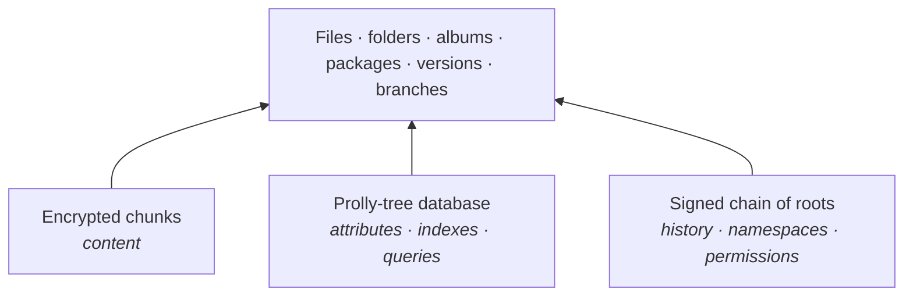

# retifs

> *Reticulum rethought how machines talk to each other. This rethinks how data lives.*

**retifs** (working title) is a distributed, always-encrypted data system built on [Reticulum](https://reticulum.network) (RNS). It combines **IPFS-style content addressing**, **BeFS-style attributes and queries** and **RNS identity and crypto**.

It has no files as such. Instead it has **records** (a stable ID, attributes and encrypted data blocks) and a **database**. Applications use it directly through a native API (records, attributes, queries, history; no paths), the way apps attach to a shared Reticulum instance. An ordinary file tree is just one view of that database, for legacy software.

> [!NOTE]
> **Status: concept phase.** There's no code yet. The threat model and the list of irreversible decisions come before code. This repo currently holds the design.

## The shift

- **From location to identity**: data isn't "on server X". It's *mine*, wherever it physically lives.
- **From files to records**: data and its meaning, not names and folders.
- **From hierarchy to queries**: structure is what you ask of the data, not where you put it.
- **From trust to crypto**: you don't have to believe the server behaves.
- **From network dependence to independence**: the network is for syncing, not a prerequisite (local-first).
- **From machine to person**: the computer is hardware, and you are your key.

## Why Reticulum

| Reticulum | retifs |
|---|---|
| No IP addresses, only identities | No file paths, only records and namespaces |
| No central address allocation | No central server or owner |
| Works over any medium | Storage over any node, disk, stick |
| Crypto by default | Crypto by default, with no unencrypted mode |
| 300 bit/s to gigabit | Same dataset from LoRa to fibre |
| Needs no infrastructure | Works offline, syncs when it can |

## Three primitives



1. **Encrypted chunks.** Content-defined chunking, and each chunk is encrypted on its own. The CID is computed over the ciphertext, so storage nodes can verify integrity without ever seeing the content.
2. **Prolly-tree database.** Signed key-value attributes on records, held in content-addressed indexes. A folder is a query, and sync transfers only the branches that differ.
3. **Signed chain of roots.** A database root is a snapshot, and commits form the history. Namespaces are RNS destinations. Permissions are capability chains, with read = key and write = signature.

See the [architecture](docs/01-architecture.md) for details.

## Principles

1. **Always encrypted.** There is no unencrypted mode. "Public" means the key travels with the reference.
2. **Three primitives**, and everything else is a combination of them.
3. **Only RNS crypto primitives** (Ed25519, X25519, HKDF, AES + HMAC-SHA256). No new crypto.
4. **Local-first.** Writes are local and immediate.
5. **The BeOS way, not the WinFS way.** Free-form attributes, schema as convention, no relational engine.
6. **The file tree is a compatibility view,** not the primary interface.
7. **Storage nodes are blind.** They hold hash-addressed noise.

## Non-goals

- IPFS compatibility.
- Unencrypted storage.
- Being a relational database (no joins, no enforced schemas).
- Guaranteed deletion across the network. Deletion means destroying the key (crypto-shredding).
- A single global namespace replacing DNS.

## Roadmap

Prototypes are throwaway. They're for learning, not for locking in the format, and every phase ends in a usable system.

| Phase | Goal | |
|---|---|---|
| 0 | **Reconnaissance**: rnfs on a test mesh, reading, YubiKey firmware | ◀ now |
| 1 | **Content layer**: Rust daemon on [Prns](https://github.com/KenAKAFrosty/Prns), per-chunk encryption, local HTTP gateway | |
| 2 | **Database**: signed attributes, Prolly-tree index, blind index, commit chain | |
| 3 | **Identity & permissions**: capability chains, group keys, YubiKey-backed RNS identity | |
| 4 | **Linux client**: FUSE mount, attributes as xattrs, query directories | |
| 5 | **Thin client**: bootable USB stick plus YubiKey, with the system loaded from your namespace | |
| later | **Haiku client**: native attributes and live queries in Tracker | |

See the [prototype plan](docs/05-prototype-plan.md).

## Documentation

| Document | Contents |
|---|---|
| [Vision](docs/00-vision.md) | Paradigm, principles, non-goals, "why not X" |
| [Architecture](docs/01-architecture.md) | The three primitives and everything built on them |
| [Irreversible decisions](docs/02-irreversible-decisions.md) | Format and crypto decisions that can't change later |
| [Prior art](docs/03-prior-art.md) | BeOS, WinFS, IPFS, rnfs, Tahoe-LAFS, Dolt and others: what worked and what didn't |
| [Threat model](docs/04-threat-model.md) | Who we defend against (draft) |
| [Prototype plan](docs/05-prototype-plan.md) | Prototype-first ordering |
| [Open questions](docs/06-open-questions.md) | Unresolved topics |
| [ADRs](docs/adr/) | Decision log |

## Contributing

Ideas are welcome in Discussions. The design direction is fixed and written down in the [vision](docs/00-vision.md). A proposal must support at least one principle and must not violate any. Big changes need a working prototype. The core is strict, while the ecosystem (applications, clients, tools) is open.

## Contact

Reach the author over Reticulum (LXMF, e.g. Sideband or NomadNet):

```
90bf8c417cd52103815eaf370387adb5
```

## License

TBD.
