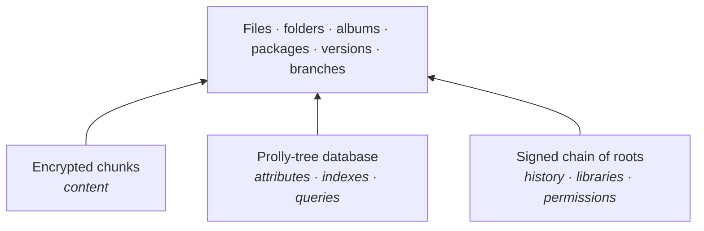

# retifs

> *Your files, photos and contacts on your own devices, encrypted, kept in sync and backed up by them, with no company in the middle.*

> [!WARNING]
> **Status: a working prototype, not for data you can't afford to lose yet.** The storage formats may still change, and the encryption is waiting for an independent review. Keep another copy of anything important.

## What is retifs?

Most people keep their photos and documents "in the cloud": on a company's servers, which you rent space on, log in to, and trust with everything in it.

retifs keeps them on **your own devices** instead: your phone, your laptop, a computer at home, a small box at a relative's. Each device has what it needs, they keep each other up to date, and between them they keep **three copies** of everything by default, so losing one device doesn't lose anything. Everything is **encrypted before it leaves the device it was made on**: a device that only stores your data for you, yours or someone else's, sees nothing but noise.

On your computer it looks like an ordinary folder (in Windows Explorer, on Linux, on Haiku). Files open as usual; the ones not on this device yet are fetched when you open them. Apps for [photos](https://github.com/vooteleaer/retifs-photos), [maps](https://github.com/vooteleaer/retifs-map), [contacts](https://github.com/vooteleaer/retifs-contacts) and [calendars](https://github.com/vooteleaer/retifs-calendar) work on the same data, and [retifs-desktop](https://github.com/vooteleaer/retifs-desktop) manages it all; they're demos, each in its own repository.

## Why not just Google Drive, Dropbox or iCloud?

| | A cloud service | retifs |
|---|---|---|
| **Who can read your files** | The company, and whoever it's made to give them to | Only you and the people you share with: the keys never leave your devices |
| **Where they are** | The company's data centres | Your devices, and the ones you choose to hold copies |
| **Without internet** | Mostly not | Yes: everything on the device works, and devices sync over whatever connects them (Wi-Fi, a cable, a radio mesh) |
| **If the company changes its prices, its terms, or shuts down** | You move everything, if you can | Nothing changes: there's no company |
| **Cost** | A monthly fee for space | The disks you already have |
| **Sharing** | A link to their server, or an account with them | With a person: an invitation they open on their device, read-only or to add to it |
| **Taking it back** | Ask the company to delete it | Delete a shared library on every member's device at once |

retifs runs on [Reticulum](https://reticulum.network), a networking system that works without any central infrastructure: over the internet, a local network, or long-range radio (LoRa) when there's nothing else. Your devices find each other by their keys, not by addresses a provider hands out.

### The honest trade-offs

- **Your devices do the work.** Copies are kept by devices that are switched on now and then. A phone alone isn't enough; a home computer or a small always-on box makes it work well.
- **You are your keys.** No company can reset your password. If every device holding your keys is lost at once, the data is lost with them, until the planned [recovery kit](docs/adr/0033-recovery.md) (24 words on paper) is built.
- **Deleting reaches devices, not memories.** Deleting a shared library removes it from every member's device, but not what someone already copied out of it.
- **It's early.** See the warning above.

## How it works, in short

- **Records, not just files.** Every photo, contact or document is a record: its content plus what's known about it (when and where a photo was taken, who's in it, which albums it's in). You find things by asking ("photos taken in Prangli in 2026"), not by remembering which folder they went in. The folder view is there for the programs that need folders.
- **Libraries.** Records live in libraries: "photos", "family", "work". Each library has its own key, and sharing a library means giving its key to someone's device.
- **Encrypted pieces.** Content is cut into pieces and each piece is encrypted on its own. Any device may hold pieces for you, the nearest first; only a device with the library's key can put them back together and read them.
- **Sync without a server.** Every change is a signed entry that every member's device merges, in any order, to the same result. Two people editing the same library offline are both kept.

The details are in the [architecture](docs/01-architecture.md).

## Try it

**[Getting started](docs/getting-started.md)** walks you through two devices and the apps in about half an hour. In short: you need Reticulum running on the machine first ([Prns](https://github.com/KenAKAFrosty/Prns), or Python `rnsd`); retifs joins it. Installers are on the [releases page](https://github.com/vooteleaer/retifs/releases).

- **Windows 10 and 11:** `retifs-setup-*.exe` installs for the current user, no administrator needed. Your libraries appear in Explorer under `%USERPROFILE%\retifs`.
- **Debian, Ubuntu, Raspberry Pi OS:** `sudo apt install ./retifs_*.deb`.
- **From source**, and everything the `retifs` command can do: [using retifs from the command line](docs/10-command-line.md).

---

## For developers

**retifs** is a distributed, always-encrypted data system built on [Reticulum](https://reticulum.network) (RNS), in Rust, with [Prns](https://github.com/KenAKAFrosty/Prns) as the transport. It combines **IPFS-style content addressing**, **BeFS-style attributes and queries** and **RNS identity and crypto**.

It has no files as such: it has **records** (a stable ID, attributes and encrypted data blocks) and a **database**. Applications use it directly through a native API (records, attributes, queries, history; no paths), the way apps attach to a shared Reticulum instance. A file tree is one view of that database, for software that needs one.

### The shift

- **From location to identity**: data isn't "on server X". It's *mine*, wherever it physically lives.
- **From files to records**: data and its meaning, not names and folders.
- **From hierarchy to queries**: structure is what you ask of the data, not where you put it.
- **From trust to crypto**: you don't have to believe the server behaves.
- **From network dependence to independence**: the network is for syncing, not a prerequisite (local-first).
- **From machine to person**: the computer is hardware, and you are your key.

### Why Reticulum

| Reticulum | retifs |
|---|---|
| No IP addresses, only identities | No file paths, only records and libraries |
| No central address allocation | No central server or owner |
| Works over any medium | Storage over any node, disk, stick |
| Crypto by default | Crypto by default, with no unencrypted mode |
| 300 bit/s to gigabit | Same dataset from LoRa to fibre |
| Needs no infrastructure | Works offline, syncs when it can |

### Three primitives



1. **Encrypted chunks.** Content-defined chunking, and each chunk is encrypted on its own. The CID is computed over the ciphertext, so storage nodes can verify integrity without ever seeing the content.
2. **Prolly-tree database.** Signed key-value attributes on records, held in content-addressed indexes. A folder is a query, and sync transfers only the branches that differ.
3. **Signed chain of roots.** Every writer signs its own chain of commits; members merge them as a CRDT. A library (namespace) is identified by its creator's key; read = key, write = a grant from a member who holds `grant`.

### Principles

1. **Always encrypted.** There is no unencrypted mode. "Public" means the key travels with the reference.
2. **Three primitives**, and everything else is a combination of them.
3. **Only RNS crypto primitives** (Ed25519, X25519, HKDF, AES + HMAC-SHA256). No new crypto.
4. **Local-first.** Writes are local and immediate.
5. **The BeOS way, not the WinFS way.** Free-form attributes, schema as convention, no relational engine.
6. **The file tree is a compatibility view,** not the primary interface.
7. **Storage nodes are blind.** They hold hash-addressed noise.
8. **Redundant by default.** Three copies from the moment something is written, one at another site once nodes say where they are.
9. **Data outlives apps.** Records belong to no app; each app shows its part and keeps what it doesn't understand.

See the [vision](docs/00-vision.md).

### Non-goals

- IPFS compatibility.
- Unencrypted storage.
- Being a relational database (no joins, no enforced schemas).
- Guaranteed deletion of what others already have. Deleting a library everywhere ([ADR-0034](docs/adr/0034-deleting-a-library.md)) reaches every member's device; beyond that, deletion means destroying the key.
- A single global namespace replacing DNS.

### What's built

| Part | | |
|---|---|---|
| Content layer | Per-chunk encryption, placement and repair, leases and storage proofs, three copies (one at another site) | prototype works |
| Database | Records and queries, multi-writer commit chains merged as a CRDT, Prolly-tree state and checkpoints, keep rules, blind index | prototype works |
| Identity and permissions | Grants (also limited by key and time), revokes with key rotation, invitations, shares, contacts | prototype works; recovery kit and YubiKey next |
| Linux | `retifsd` as a user service, FUSE mount with xattrs and query folders, local web gateway, `.deb` packages | prototype works |
| Windows | Explorer folder (Cloud Files: placeholders fetched on open), installer | prototype works |
| Haiku | Libraries as volumes with native attributes and live queries in Tracker, packages | prototype works |
| Android | `retifsd` inside an app, on Prns's shared instance | prototype works |
| Thin client | Bootable USB stick plus YubiKey, the system loaded from your library | not started |

See the [prototype plan](docs/05-prototype-plan.md).

### Documentation

| Document | Contents |
|---|---|
| [Vision](docs/00-vision.md) | Paradigm, principles, non-goals, "why not X" |
| [Architecture](docs/01-architecture.md) | The three primitives and everything built on them |
| [Irreversible decisions](docs/02-irreversible-decisions.md) | Format and crypto decisions that can't change later |
| [Prior art](docs/03-prior-art.md) | BeOS, WinFS, IPFS, rnfs, Tahoe-LAFS, Dolt and others: what worked and what didn't |
| [Threat model](docs/04-threat-model.md) | Who we defend against (draft) |
| [Prototype plan](docs/05-prototype-plan.md) | Prototype-first ordering |
| [Open questions](docs/06-open-questions.md) | Unresolved topics |
| [Native API](docs/07-api.md) | `libretifs`: records, attributes, blocks, queries, history (draft) |
| [External review](docs/09-external-review.md) | What the crypto review should look at |
| [Getting started](docs/getting-started.md) | Two devices and the apps, step by step (test release) |
| [Command line](docs/10-command-line.md) | Installing, and every `retifs` command by task |
| [ADRs](docs/adr/) | Decision log |

## Contributing

Ideas are welcome in Discussions. The design direction is fixed and written down in the [vision](docs/00-vision.md). A proposal must support at least one principle and must not violate any. Big changes need a working prototype. The core is strict, while the ecosystem (applications, clients, tools) is open.

## Contact

Reach the author over Reticulum (LXMF, e.g. Sideband or NomadNet):

```
90bf8c417cd52103815eaf370387adb5
```

## License

[MIT](LICENSE)
